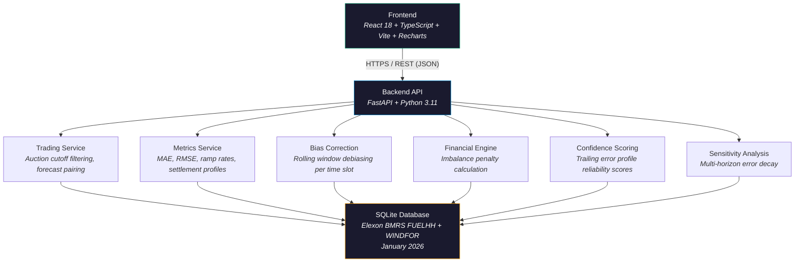

# WindCast Analytics

**Day-Ahead Wind Generation Forecasting and Decision Terminal for UK Wholesale Electricity Markets**

<p>
  <a href="https://kjhwr-jet.vercel.app"></a>
  <a href="https://windcast-analytics-api.onrender.com/docs"></a>
</p>

---

## Problem

A UK energy utility buys power one day before delivery in the Day-Ahead auction. Since wind output depends on weather, forecasts are never perfect. When the forecast is wrong, the utility pays **imbalance penalties** -- and these penalties are not symmetric. Over-predicting wind costs more than under-predicting it.

Standard accuracy metrics like MAE (Mean Absolute Error) treat both directions equally. The real market does not.

WindCast closes this gap by:

- Locking forecasts at the auction deadline (11:00 GMT, one day before delivery) so no future data leaks in
- Calculating the actual financial penalty for each forecast error using real market pricing rules
- Correcting systematic forecast bias to reduce penalty exposure

---

## Data Source

All data comes directly from the **Elexon BMRS API** for **January 2026**:

- **FUELHH** (actual wind generation, half-hourly): 1,488 records (31 days × 48 settlement periods)
- **WINDFOR** (wind generation forecasts, hourly): ~18,000+ raw records expanded to ~35,000+ half-hourly records

WINDFOR forecasts are published hourly by Elexon. Since the UK electricity market settles on half-hourly intervals, each hourly forecast is mapped to two settlement periods (e.g., a forecast for 14:00 applies to both SP 29 at 14:00–14:30 and SP 30 at 14:30–15:00).

No synthetic or seed data is used in the deployed application. The backend fetches directly from `data.elexon.co.uk` on first startup and caches in SQLite.

---

## Architecture



**Hosting**: Frontend on Vercel, Backend on Render.

---

## Repository Structure

```
├── backend/                          # FastAPI analytical backend service
│   ├── app/
│   │   ├── api/                      # REST API routing layer
│   │   │   └── routes.py             # Route handlers for overview, metrics, timeseries, debiasing, confidence
│   │   ├── ingestion/                # Data pipelines for Elexon BMRS
│   │   │   ├── elexon_client.py      # HTTP client for FUELHH actuals & WINDFOR forecasts
│   │   │   ├── pipeline.py           # Ingestion orchestrator, WINDFOR hourly-to-SP expansion
│   │   │   └── seed_data.py          # Fallback generator for isolated environments
│   │   ├── schemas/                  # Pydantic response models
│   │   │   └── responses.py          # Data contract models for API payloads
│   │   ├── services/                 # Core market domain & analytics logic
│   │   │   ├── trading.py            # Strict D-1 11:00Z cutoff pairing engine
│   │   │   ├── metrics.py            # MAE, RMSE, MAPE, full-distribution P90/P95
│   │   │   ├── financial.py          # UK dual cash-out imbalance penalty calculator
│   │   │   ├── bias_correction.py    # Per-settlement-period trailing bias removal engine
│   │   │   ├── forecast_model.py     # Trailing historical error reliability scorer
│   │   │   └── sensitivity.py        # Multi-horizon forecast accuracy sensitivity
│   │   ├── config.py                 # Environment configuration & market parameters
│   │   ├── database.py               # SQLite schema initialization and connection manager
│   │   └── main.py                   # FastAPI app entry point, CORS, startup lifecycle
│   ├── data/
│   │   └── energy_analytics.db       # Embedded SQLite database (January 2026 Elexon data)
│   ├── tests/                        # 42-test automated verification suite
│   │   ├── test_api.py               # API status codes and endpoint payload contracts
│   │   ├── test_ingestion.py         # Pipeline, DB schema, and WINDFOR expansion tests
│   │   ├── test_metrics.py           # Mathematical invariants (RMSE >= MAE, division safety)
│   │   └── test_services.py          # Gate closure cutoff tests, duplicate latest-wins, per-SP bias, reserves
│   ├── Dockerfile                    # Container definition for backend
│   └── requirements.txt              # Pinned Python dependencies
├── frontend/                         # React 18 trading terminal frontend
│   ├── src/
│   │   ├── components/               # Modular analytical UI cards & charts
│   │   │   ├── Header.tsx            # Navigation, status indicators, and data source badge
│   │   │   ├── DecisionBar.tsx       # Date range, gate closure, and parameter controls
│   │   │   ├── KpiCards.tsx          # Headline KPIs: MAE, RMSE, MAPE, imbalance costs
│   │   │   ├── TimeSeriesChart.tsx   # Interactive actual vs forecast line chart
│   │   │   ├── SettlementPeriodProfile.tsx # 48-period daily error shape & peak indicators
│   │   │   ├── DailyBreakdown.tsx    # Daily progression and trends
│   │   │   ├── FinancialCalculator.tsx # Dynamic SBP/SSP market stress simulator
│   │   │   ├── BiasCorrectionLab.tsx # Interactive debiasing lab with window selector
│   │   │   ├── GateClosureCurve.tsx  # Forecast decay across lead times (D-1 11:00 to gate)
│   │   │   ├── ForecastConfidenceLab.tsx # Reliability score and historical error tier
│   │   │   └── ProcurementInsight.tsx# Thermal reserve procurement recommendations
│   │   ├── services/                 # Frontend API client
│   │   │   └── api.ts                # Axios-based typed HTTP client with error handling
│   │   ├── types/                    # TypeScript interfaces matching backend models
│   │   │   └── index.ts              # Data contracts for all analytical endpoints
│   │   ├── App.tsx                   # Main dashboard layout, state management, API sync
│   │   ├── index.css                 # Custom CSS design system (dark trading terminal)
│   │   └── main.tsx                  # React entry point
│   ├── Dockerfile                    # Multi-stage production container build (Vite + Nginx)
│   ├── nginx.conf                    # Nginx reverse proxy configuration for Docker
│   ├── package.json                  # NPM packages & build scripts
│   ├── vercel.json                   # Vercel deployment and routing configuration
│   └── vite.config.ts                # Vite bundler configuration
├── docs/                             # In-depth architectural & domain documentation
│   └── ARCHITECTURE_AND_DOMAIN_GUIDE.md # Technical lead review & domain walkthrough
├── docker-compose.yml                # One-command local production stack
└── render.yaml                       # Render cloud deployment blueprint
```

---

## How It Works

### 1. Auction Cutoff (Zero-Lookahead)

The Day-Ahead auction closes at 11:00 GMT the day before delivery. The system only uses forecasts published before this deadline:

```
Cutoff = (Delivery Date - 1 day) + 11:00 GMT
```

Any forecast published after the cutoff is excluded. This guarantees no future information leaks into predictions.

If no forecast exists for a settlement period at gate closure, that interval is excluded from the paired series (not imputed with the actual value, which would artificially reduce error to zero).

### 2. Penalty Calculation

When wind output differs from the forecast, penalties apply:

**Over-predicted** (forecast > actual) -- the utility is short on power and must buy emergency supply at a higher price (System Buy Price):

```
Deficit Penalty = (Forecast - Actual) × 0.5h × (Buy Price - Auction Price)
```

**Under-predicted** (forecast < actual) -- the utility has excess power and must sell at a lower price (System Sell Price):

```
Surplus Loss = (Actual - Forecast) × 0.5h × (Auction Price - Sell Price)
```

### 3. Bias Correction

Forecasts often have a consistent lean (e.g., always over-predicting by some MW). The system detects and corrects this using a rolling average of recent errors:

```
Bias = Average of (Forecast - Actual) over past W days, per time slot

Corrected Forecast = max(800 MW, Original Forecast - Bias)
```

The 800 MW floor prevents corrections from producing impossibly low values. Configurable windows: 1, 3, or 7 days.

### 4. Reserve Sizing

How much backup thermal capacity should the utility keep ready? P90 and P95 buffers are computed over the full error distribution (all intervals, not just deficit intervals) to give a true population percentile.

### 5. Reliability Scoring

A trailing historical error profile scores each forecast 0–100% based on how large the average absolute error has been for the same settlement period over the preceding days. This is fully out-of-sample (no data leakage) — each day's confidence is based only on errors from previous days.

---

## API Endpoints

Interactive docs: [windcast-analytics-api.onrender.com/docs](https://windcast-analytics-api.onrender.com/docs)

| Endpoint | What it returns |
|:--|:--|
| `GET /api/health` | System status, database counts, and data source (live_elexon or seed) |
| `GET /api/overview` | Summary KPIs for a date range |
| `GET /api/timeseries` | Half-hourly actual vs forecast series |
| `GET /api/metrics` | Accuracy metrics: MAE, RMSE, MAPE, reserve buffers |
| `GET /api/settlement-analysis` | 48-period daily profile with peak hour flags |
| `GET /api/daily-breakdown` | Day-by-day error trends for a date range |
| `GET /api/financial-impact` | Penalty exposure under configurable price scenarios |
| `GET /api/bias-correction` | Debiased forecast series and error improvement |
| `GET /api/gate-closure-sensitivity` | How accuracy changes across forecast horizons |
| `GET /api/forecast-confidence` | Reliability score with error drivers |

Common parameters: `start_date`, `end_date`, `gate_closure_hour`, `window_days`, `sbp`, `ssp`, `da_price`.

---

## Testing

```bash
cd backend
python -m pytest tests/ -v
```

### What the tests verify

| Area | What is tested |
|:--|:--|
| Data source | Database contains real Elexon data (not seed), data_source = live_elexon |
| WINDFOR expansion | Hourly forecasts correctly mapped to both odd and even settlement periods |
| Gate closure cutoff | Later publish (16:30) dropped when gate is 11:00, earlier publish (10:00) selected |
| Missing forecast | Intervals without a DA forecast are excluded, not imputed with actual |
| Metric invariants | RMSE >= MAE, zero-division safety, ramp edge cases |
| Financial rules | Zero error = zero penalty, higher SBP = higher cost |
| Bias correction | Physical floor (800 MW) enforced, systematic bias removed |
| Confidence scores | All scores bounded 0–100%, valid tiers |
| All API endpoints | Correct status codes, response structure, date range filtering |

---

## Live Deployments

| Component | URL |
|:--|:--|
| Dashboard | [kjhwr-jet.vercel.app](https://kjhwr-jet.vercel.app) |
| API Docs | [windcast-analytics-api.onrender.com/docs](https://windcast-analytics-api.onrender.com/docs) |
| Health Check | [windcast-analytics-api.onrender.com/api/health](https://windcast-analytics-api.onrender.com/api/health) |

---

## Running Locally

**Docker (recommended):**

```bash
git clone https://github.com/FARINATTAR/kjhwr-.git
cd kjhwr-
docker compose up --build -d
```

Frontend: `http://localhost:3000` | Backend: `http://localhost:8000/docs`

**Manual setup:**

```bash
# Backend
cd backend
python -m venv .venv
.venv\Scripts\activate          # Windows
source .venv/bin/activate       # macOS / Linux
pip install -r requirements.txt
python -m uvicorn app.main:app --host 0.0.0.0 --port 8000 --reload

# Frontend
cd frontend
npm install
npm run dev                     # Opens at http://localhost:5173
```

---

## Tech Stack

| Layer | Technology |
|:--|:--|
| Frontend | React 18, TypeScript, Vite, Recharts |
| Backend | Python 3.11, FastAPI, Uvicorn, Pydantic v2 |
| Database | SQLite with temporal indexing |
| Data Source | Elexon BMRS API (FUELHH + WINDFOR) |
| CI/CD | GitHub Actions, Vercel, Render |
| Testing | pytest |

---

## AI Tools Used

Built with pair-programming assistance from **Antigravity IDE**.

---

## WINDFOR Alignment Rule

Elexon WINDFOR provides forecasts with hourly `startTime` values (e.g. `2026-01-01T00:00:00Z`). The UK settlement market operates on half-hourly intervals. Each hourly forecast is duplicated to cover both half-hours:

| WINDFOR startTime | Settlement Period 1 | Settlement Period 2 |
|:--|:--|:--|
| 00:00 | SP 1 (00:00–00:30) | SP 2 (00:30–01:00) |
| 01:00 | SP 3 (01:00–01:30) | SP 4 (01:30–02:00) |
| ... | ... | ... |
| 23:00 | SP 47 (23:00–23:30) | SP 48 (23:30–00:00) |

January 2026 is entirely in GMT (no daylight saving time transitions), so UTC timestamps map directly to settlement periods without offset.
