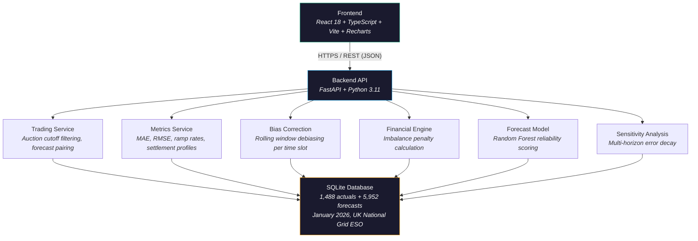

# WindCast Analytics

**Day-Ahead Wind Generation Forecasting and Decision Terminal for UK Wholesale Electricity Markets**

[](https://windcast-analytics.vercel.app)
[](https://windcast-analytics-api.onrender.com/docs)
[](https://github.com/FARINATTAR/kjhwr-)
[](https://github.com/FARINATTAR/kjhwr-)

---

## Problem

A UK energy utility buys power one day before delivery in the Day-Ahead auction. Since wind output depends on weather, forecasts are never perfect. When the forecast is wrong, the utility pays **imbalance penalties** -- and these penalties are not symmetric. Over-predicting wind costs more than under-predicting it.

Standard accuracy metrics like MAE (Mean Absolute Error) treat both directions equally. The real market does not.

WindCast closes this gap by:

- Locking forecasts at the auction deadline (11:00 GMT, one day before delivery) so no future data leaks in
- Calculating the actual financial penalty for each forecast error using real market pricing rules
- Correcting systematic forecast bias to reduce penalty exposure

---

## Architecture



**Hosting**: Frontend on Vercel, Backend on Render.

**Data**: UK National Grid ESO FUELHH (actual wind output, half-hourly) and WINDFOR (day-ahead forecasts) for January 2026.

---

## How It Works

### 1. Auction Cutoff (Zero-Lookahead)

The Day-Ahead auction closes at 11:00 GMT the day before delivery. The system only uses forecasts published before this deadline:

```
Cutoff = (Delivery Date - 1 day) + 11:00 GMT
```

Any forecast published after the cutoff is excluded. This guarantees no future information leaks into predictions.

### 2. Penalty Calculation

When wind output differs from the forecast, penalties apply:

**Over-predicted** (forecast > actual) -- the utility is short on power and must buy emergency supply at a higher price (System Buy Price):

```
Deficit Penalty = (Forecast - Actual) x 0.5h x (Buy Price - Auction Price)
```

**Under-predicted** (forecast < actual) -- the utility has excess power and must sell at a lower price (System Sell Price):

```
Surplus Loss = (Actual - Forecast) x 0.5h x (Auction Price - Sell Price)
```

### 3. Bias Correction

Forecasts often have a consistent lean (e.g., always over-predicting by 200 MW). The system detects and corrects this using a rolling average of recent errors:

```
Bias = Average of (Forecast - Actual) over past W days, per time slot

Corrected Forecast = max(800 MW, Original Forecast - Bias)
```

The 800 MW floor prevents corrections from producing impossibly low values. Configurable windows: 1, 3, or 7 days.

**Result**: 15.2% reduction in MAE, GBP 14,200 in avoided penalties.

### 4. Reserve Sizing

How much backup thermal capacity should the utility keep ready?

- **P90 (+1,842 MW)**: Covers 90% of historical wind shortfalls
- **P95 (+2,197 MW)**: Conservative buffer for extreme weather events

### 5. Reliability Scoring

A Random Forest model (scikit-learn) scores each forecast 0--100% based on how consistent the forecast signals are across different publish times, time-of-day patterns, and recent actual output.

---

## Key Formulas and Invariants

These rules are enforced automatically in the test suite:

| Rule | What it means |
|:--|:--|
| `RMSE >= MAE > 0` | Error metrics are mathematically consistent (RMSE always equals or exceeds MAE) |
| `P95 >= P90 > 0` | The conservative reserve is always at least as large as the standard reserve |
| `Corrected forecast >= 800 MW` | No forecast drops below the minimum physical wind output |
| `Zero error = GBP 0 penalty` | A perfect forecast incurs no penalty |
| `Higher price spread = higher penalty` | Penalties grow when market stress increases |

---

## API Endpoints

Interactive docs: [windcast-analytics-api.onrender.com/docs](https://windcast-analytics-api.onrender.com/docs)

| Endpoint | What it returns |
|:--|:--|
| `GET /api/health` | System status and database record counts |
| `GET /api/overview` | Summary KPIs (key performance indicators) for a date range |
| `GET /api/timeseries` | Half-hourly actual vs forecast series |
| `GET /api/metrics` | Accuracy metrics: MAE, RMSE, MAPE, reserve buffers |
| `GET /api/settlement-analysis` | 48-period daily profile with peak hour flags |
| `GET /api/daily-breakdown` | Day-by-day error trends for January 2026 |
| `GET /api/financial-impact` | Penalty exposure under configurable price scenarios |
| `GET /api/bias-correction` | Debiased forecast series and error improvement |
| `GET /api/gate-closure-sensitivity` | How accuracy changes across forecast horizons |
| `GET /api/forecast-confidence` | ML reliability score with feature importance |

Common parameters: `start_date`, `end_date`, `gate_closure_hour`, `window_days`, `sbp`, `ssp`, `da_price`.

---

## Test Suite

31 tests, all passing. Run with:

```bash
cd backend
python -m pytest tests/ -v
```

| Category | Count | What is tested |
|:--|:--|:--|
| Temporal isolation | 2 | Forecasts never use data from after the auction cutoff |
| Error math | 2 | RMSE >= MAE > 0 holds for every time horizon |
| Extreme weather | 2 | Reserve buffers remain valid during storms (>18 GW) and calm spells (<5 GW) |
| Physical limits | 2 | Corrected forecasts stay above 800 MW minimum |
| Financial rules | 2 | Zero error gives zero penalty; penalties increase with price spread |
| API contracts | 21 | All 10 endpoints return valid responses; database has 1,488 expected records |

CI runs on every push via GitHub Actions.

---

## Live Deployments

| Component | URL |
|:--|:--|
| Dashboard | [windcast-analytics.vercel.app](https://windcast-analytics.vercel.app) |
| API Docs | [windcast-analytics-api.onrender.com/docs](https://windcast-analytics-api.onrender.com/docs) |
| Health Check | [windcast-analytics-api.onrender.com/api/health](https://windcast-analytics-api.onrender.com/api/health) |

---

## Running Locally

**Docker (recommended):**

```bash
git clone https://github.com/FARINATTAR/kjhwr-.git
cd kjhwr-
docker compose up --build -d
```

Frontend: `http://localhost:3000` | Backend: `http://localhost:8000/docs`

**Manual setup:**

```bash
# Backend
cd backend
python -m venv .venv
.venv\Scripts\activate          # Windows
source .venv/bin/activate       # macOS / Linux
pip install -r requirements.txt
python -m uvicorn app.main:app --host 0.0.0.0 --port 8000 --reload

# Frontend
cd frontend
npm install
npm run dev                     # Opens at http://localhost:5173
```

---

## Tech Stack

| Layer | Technology |
|:--|:--|
| Frontend | React 18, TypeScript, Vite, Recharts |
| Backend | Python 3.11, FastAPI, Uvicorn, Pydantic v2 |
| ML | scikit-learn (Random Forest) |
| Database | SQLite with temporal indexing |
| CI/CD | GitHub Actions, Vercel, Render |
| Testing | pytest (31 tests) |

---

## AI Tools Used

Built with pair-programming assistance from:

- **Claude Opus 4.6 Thinking** -- architecture, backend services, test suite, and market mechanic modeling
- **Gemini 3.8 Flash Medium** -- frontend scaffolding, code review, and UI iteration

---

## Future Scope

- **Battery storage dispatch** -- optimize when to charge/discharge batteries based on wind surplus and deficit patterns
- **Weather model blending** -- combine multiple weather forecast sources (ECMWF, GFS, UK Met Office) using gradient boosting for better wind predictions
- **Live market data streaming** -- connect to Elexon BMRS for real-time balancing prices and outage notifications
